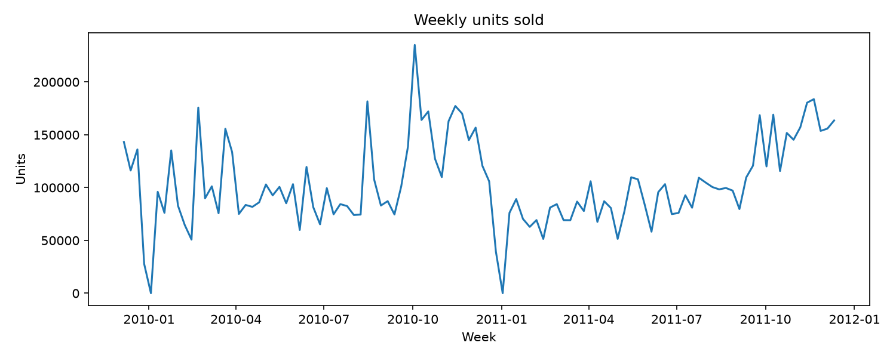
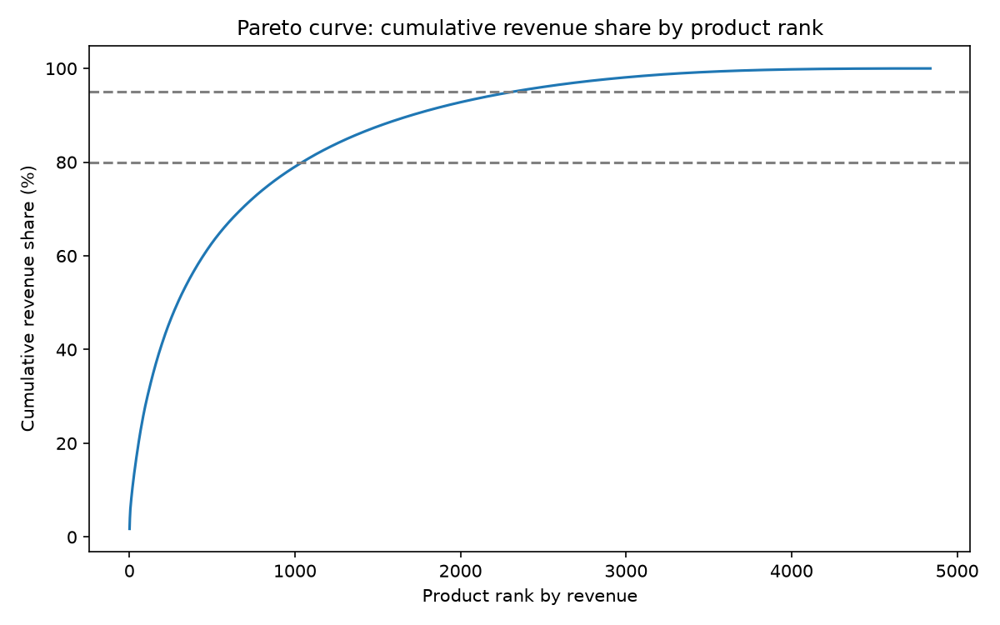
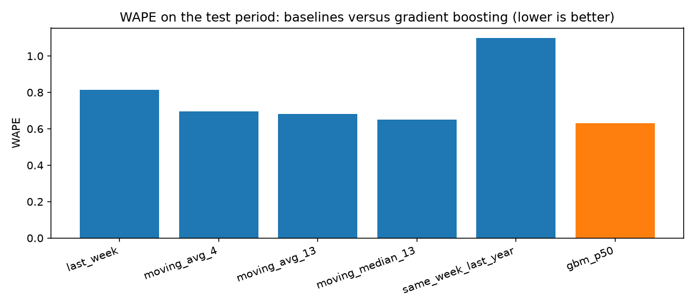
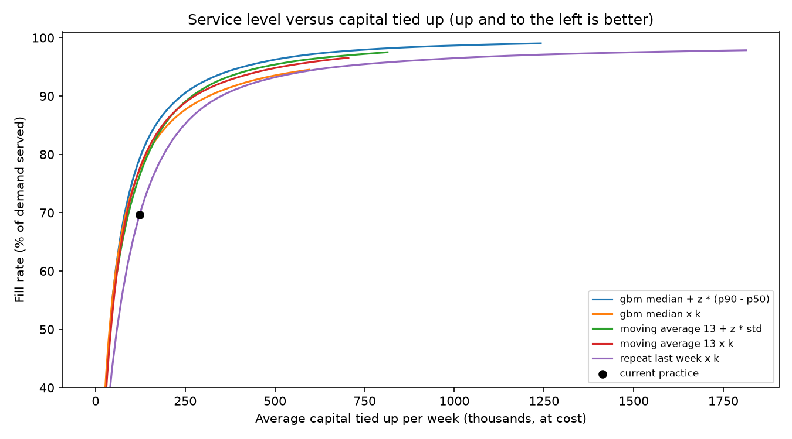

# StockMind: demand forecasting and ordering decisions

StockMind forecasts weekly demand for each product with a prediction interval and tests how the forecasts change ordering decisions.
It is built on about one million real retail transactions (UCI Online Retail II) and evaluated with a strict time-based backtest:
models learn only from the past and are scored on the last 26 weeks.

**Honest summary:** the quantile model beats simple rules clearly, and beats a well-tuned classical safety-stock baseline by a small margin.
Cost figures depend on assumptions that are not in the data (see Limitations).

## Results

### Data

- Raw rows: 1,067,371. After cleaning: 1,001,935 (93.9% kept).

| cleaning rule | rows removed |
| --- | --- |
| sales fully cancelled within 24 hours | 1,410 |
| cancelled invoices (start with C) | 19,494 |
| quantity <= 0 | 3,457 |
| price <= 0 | 2,750 |
| non-product stock codes | 4,715 |
| exact duplicate rows | 33,610 |

- Products with enough history to model: 2,042 of 4,838, covering 81% of all units sold.






### Forecast accuracy on the last 26 weeks (same product-weeks for every method)

| method | WAPE (lower is better) | bias (positive = over-forecast) |
| --- | --- | --- |
| gbm_p50 | 0.631 | -0.296 |
| moving_median_13 | 0.650 | -0.375 |
| moving_avg_13 | 0.680 | -0.131 |
| moving_avg_4 | 0.696 | -0.061 |
| last_week | 0.814 | -0.032 |
| same_week_last_year | 1.099 | +0.279 |

- The median forecast of the model has WAPE 0.631, which is 2.9% lower than the best simple baseline (`moving_median_13`, 0.650) and 22.5% lower than repeating last week (0.814).
- The p10 to p90 interval covers 89.7% of actual values (target 80%), so the intervals are wider than needed.
- The median under-forecasts total units (negative bias). This is expected for skewed demand, so ordering uses the upper part of the interval.




### Ordering decisions

Each ordering policy has one dial: a multiplier k or a safety factor z. In-sample sweep (the dial was swept on the evaluated weeks, so this view is optimistic for every policy):

| policy | capital for 90% fill | capital for 95% fill |
| --- | --- | --- |
| gbm median + z * (p90 - p50) | 238,883 | 410,574 |
| gbm median x k | 315,540 | not reached |
| moving average 13 + z * std | 269,348 | 467,386 |
| moving average 13 x k | 275,606 | 516,392 |
| repeat last week x k | 350,071 | 673,467 |

- Against the best tuned classical baseline, the quantile model needs 11.3% less capital at 90% fill and 12.2% less capital at 95% fill.




### Out-of-sample check of the ordering policies

The dial (k or z) of each policy is chosen on the first 13 test weeks and then fixed and evaluated on the last 13 weeks (the busy autumn season).

Dial chosen by: **lowest total cost**

| policy | dial | fill rate | capital | total cost |
| --- | --- | --- | --- | --- |
| repeat last week x k | 4.3 | 95.3% | 868,581 | 102,165 |
| moving average 13 x k | 8.3 | 96.6% | 766,731 | 79,603 |
| moving average 13 + z * std | 6.7 | 96.8% | 688,601 | 72,129 |
| gbm median x k | 11.7 | 97.0% | 1,095,551 | 89,312 |
| gbm median + z * (p90 - p50) | 4.6 | 97.8% | 798,343 | 66,915 |

Dial chosen by: **smallest parameter reaching 95% fill**

| policy | dial | fill rate | capital | total cost |
| --- | --- | --- | --- | --- |
| repeat last week x k | 7.2 | 97.2% | 1,575,019 | 118,033 |
| moving average 13 x k | 6.8 | 95.6% | 614,715 | 83,116 |
| moving average 13 + z * std | 5.0 | 95.5% | 520,627 | 78,011 |
| gbm median x k | 12.0 | 97.0% | 1,126,245 | 89,903 |
| gbm median + z * (p90 - p50) | 2.9 | 95.6% | 506,688 | 74,486 |

- With the dial chosen by lowest cost, the quantile model's total cost is 7.2% lower than the best tuned baseline and 34.5% lower than repeat last week x k.

## Limitations

- One dataset from one UK wholesaler, two years of history, one test window of 26 weeks.
- Only one autumn is available for training, so seasonality is learned from a single cycle.
- Cost figures use assumptions that are not in the data: unit cost is 60% of the selling price and holding stock costs 20% of its value per year.
- The ordering simulation uses zero lead time, lost sales, and ignores capital limits and shelf space.
- The model is trained once; weekly retraining was not tested.
- Prediction intervals are conservative (coverage above the 80% target).
- The "current practice" (repeat last week) is an assumption, not something observed in the data.

## Method

1. **Clean:** remove cancellations, non-positive quantities and prices, fees and vouchers, duplicates, and sales cancelled within 24 hours.
2. **Weekly table:** units per product and week. Zeros count only between a product's first and last sale; the incomplete first and last weeks are dropped.
3. **Segment:** ABC by revenue, Syntetos-Boylan demand classes (smooth, erratic, intermittent, lumpy) and k-means clusters.
4. **Baselines:** repeat last week, 4-week and 13-week averages, 13-week median, same week last year.
5. **Model:** histogram-based gradient boosting with quantile loss (p10, p50, p90), trained once on weeks before the test period, with features built only from earlier weeks.
6. **Decide:** simulate weekly order-up-to policies and compare service level against capital tied up, first in-sample and then out-of-sample.

## How to run

```bash
python -m venv .venv && source .venv/bin/activate
pip install -r requirements.txt
# put online_retail_II.xlsx (UCI Machine Learning Repository) in data/
python src/load_data.py
python src/clean_data.py
python src/eda.py
python src/build_weekly.py
python src/segment_products.py
python src/forecast_model.py
python src/decision_backtest.py
python src/out_of_sample_check.py
python src/make_readme.py
streamlit run app/dashboard.py
```

## Project structure

```
src/        pipeline scripts (cleaning, weekly table, segmentation, baselines, model, backtests)
app/        Streamlit dashboard
reports/    result tables and figures
data/       generated data (not committed)
PROJECT_LOG.md   step-by-step log of decisions and findings
```

## Data

Chen, D. (2012). Online Retail II [Dataset]. UCI Machine Learning Repository. https://doi.org/10.24432/C5CG6D
Check the license terms on the dataset page before reuse.
